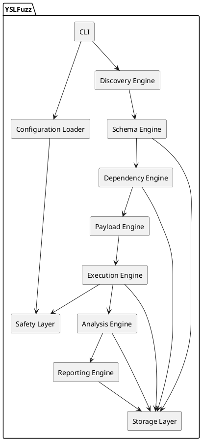
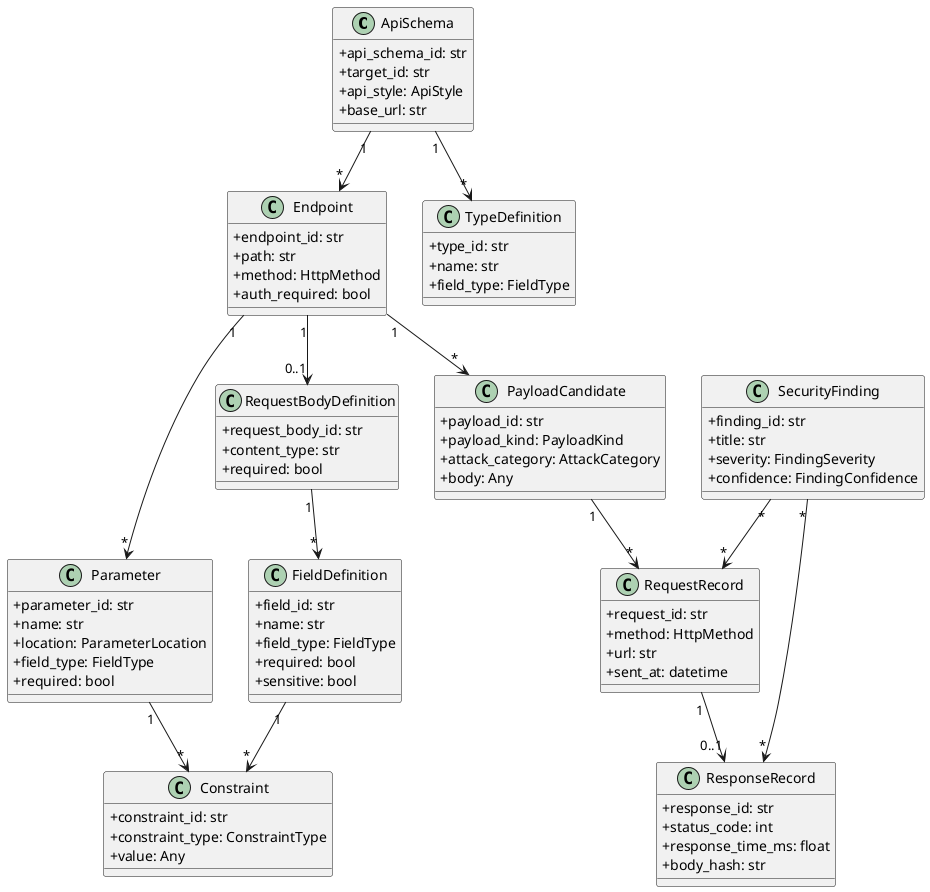
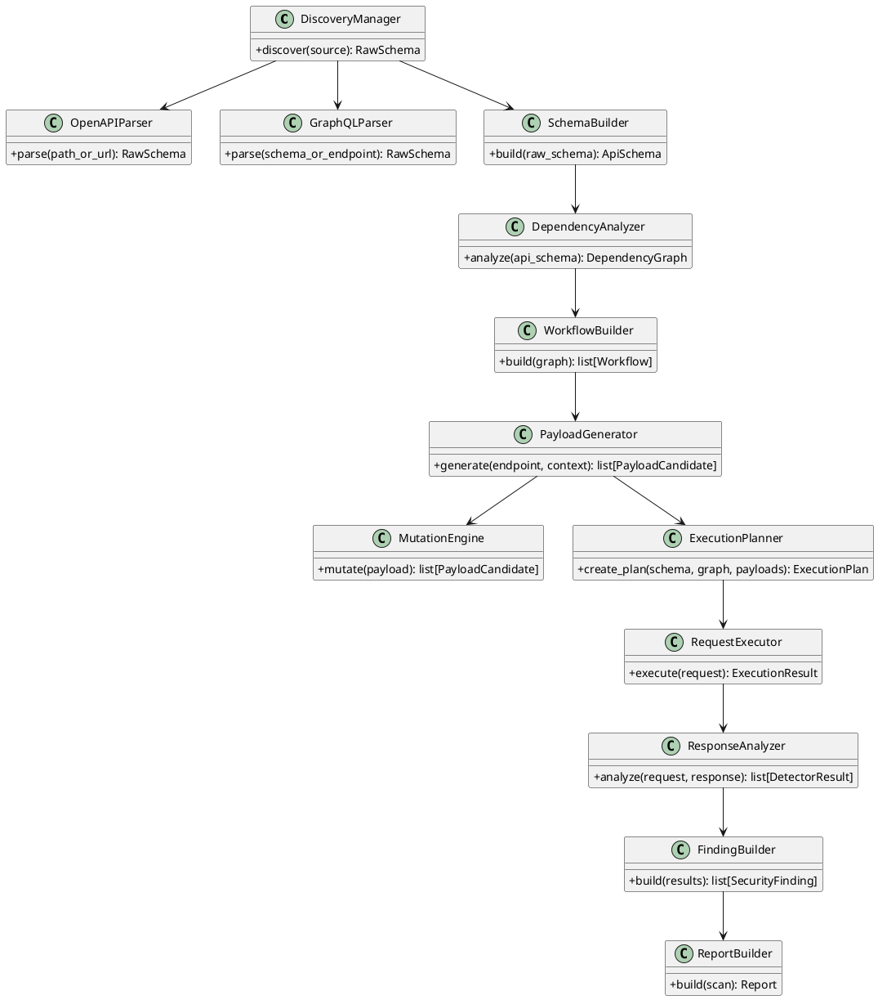
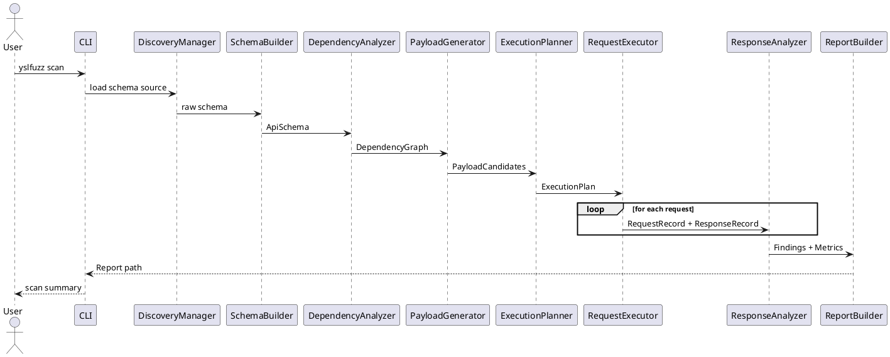
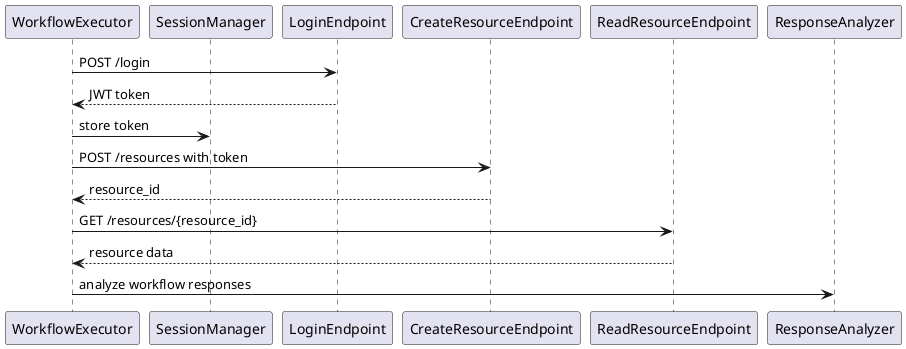
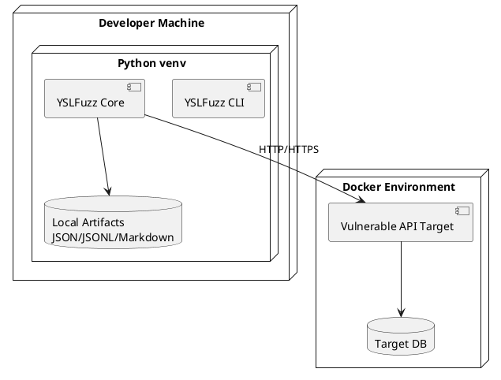

# YSLFuzz — Software Design Document (SDD)

**Project:** YSLFuzz  
**Subtitle:** Schema-Aware Stateful Fuzzer for REST and GraphQL APIs  
**Version:** 1.0  
**Author:** Christian Ruzza  
**Status:** Draft operativo pre-sviluppo  

---

## 1. Introduction

### 1.1 Purpose

Questo documento descrive la progettazione software di **YSLFuzz**, un framework per l'analisi automatizzata di vulnerabilità in API REST e GraphQL tramite fuzzing schema-aware e stateful.

L'SDD definisce:

- architettura generale;
- componenti principali;
- responsabilità dei moduli;
- flussi di esecuzione;
- diagrammi UML in PlantUML;
- struttura repository;
- principali interfacce interne;
- criteri di estendibilità, sicurezza e testabilità.

### 1.2 Product Scope

YSLFuzz ha l'obiettivo di migliorare la qualità del fuzzing API rispetto a strumenti black-box tradizionali, usando informazioni strutturali derivate da:

- OpenAPI/Swagger;
- GraphQL schema/introspection;
- esempi e constraint;
- valori osservati durante l'esecuzione.

### 1.3 Design Goals

Gli obiettivi progettuali sono:

1. rappresentare REST e GraphQL tramite un modello interno uniforme;
2. generare payload validi e mutati in base allo schema;
3. supportare workflow stateful;
4. rilevare anomalie e vulnerabilità con detector modulari;
5. produrre report riproducibili;
6. mantenere uno scope realistico per una tesi di circa tre mesi.

---

## 2. Architectural Overview

### 2.1 Logical Pipeline

```text
Schema Source
    ↓
Discovery Engine
    ↓
Schema Engine
    ↓
Dependency Engine
    ↓
Payload Engine
    ↓
Execution Engine
    ↓
Analysis Engine
    ↓
Reporting Engine
```

### 2.2 Main Components

| Component | Responsibility |
|---|---|
| Discovery Engine | Importare OpenAPI, Swagger e GraphQL schema |
| Schema Engine | Normalizzare lo schema in un modello interno |
| Dependency Engine | Inferire relazioni e workflow tra endpoint |
| Payload Engine | Generare payload validi, boundary, mutati e offensivi |
| Execution Engine | Eseguire richieste HTTP in modo asincrono e controllato |
| Analysis Engine | Analizzare le risposte e produrre finding |
| Reporting Engine | Esportare risultati, metriche e report |
| Safety Layer | Applicare scope, rate limit, redazione segreti e controlli operativi |

---

## 3. Component Diagram



---

## 4. Module Design

## 4.1 CLI Module

### Responsibility

Espone l'interfaccia a riga di comando.

### Main commands

```text
yslfuzz init
yslfuzz scan --schema openapi.yaml --target http://localhost:8080
yslfuzz report --scan scan_id --format json
yslfuzz validate-config yslfuzz.yaml
```

### Suggested classes

- `YSLFuzzCLI`
- `CommandContext`
- `CLIOutputRenderer`

---

## 4.2 Configuration Loader

### Responsibility

Caricare e validare configurazioni di progetto e scan.

### Input

- YAML config;
- CLI flags;
- environment variables;
- default values.

### Output

- `Project`
- `Target`
- `ScanConfiguration`
- `AuthProfile`
- `ScopeDefinition`

---

## 4.3 Discovery Engine

### Responsibility

Importare specifiche API e produrre una rappresentazione grezza ma strutturata.

### Supported sources MVP

- OpenAPI 3.x file;
- OpenAPI 3.x URL;
- Swagger 2.0 best effort;
- GraphQL introspection best effort.

### Suggested classes

- `DiscoveryManager`
- `OpenAPIParser`
- `SwaggerParser`
- `GraphQLParser`
- `SchemaSourceResolver`

### Output

- `SchemaSource`
- raw schema object
- parsing diagnostics

---

## 4.4 Schema Engine

### Responsibility

Convertire lo schema sorgente in modello interno normalizzato.

### Suggested classes

- `SchemaBuilder`
- `EndpointBuilder`
- `TypeResolver`
- `ConstraintExtractor`
- `AuthSchemeExtractor`

### Output

- `ApiSchema`
- `Endpoint`
- `Parameter`
- `RequestBodyDefinition`
- `ResponseDefinition`
- `FieldDefinition`
- `TypeDefinition`
- `Constraint`

---

## 4.5 Dependency Engine

### Responsibility

Inferire dipendenze tra endpoint e generare workflow semplici.

### Inference examples

```text
POST /users returns id
GET /users/{id} consumes id
PUT /users/{id} consumes id
DELETE /users/{id} consumes id
```

### Suggested classes

- `DependencyAnalyzer`
- `DependencyGraphBuilder`
- `WorkflowBuilder`
- `ValueBindingInferer`
- `ExtractorInferer`

### Output

- `DependencyGraph`
- `DependencyNode`
- `DependencyEdge`
- `Workflow`
- `WorkflowStep`
- `VariableBinding`
- `ValueExtractor`

---

## 4.6 Payload Engine

### Responsibility

Generare payload basati su schema e mutazioni controllate.

### Payload categories

- valid payload;
- boundary payload;
- mutated payload;
- attack payload;
- control payload.

### Suggested classes

- `PayloadGenerator`
- `ValidPayloadFactory`
- `BoundaryPayloadFactory`
- `MutationEngine`
- `AttackPayloadFactory`
- `PayloadGenerationContext`

### Safety rule

I payload potenzialmente distruttivi o ad alto rischio devono essere disabilitati di default.

---

## 4.7 Execution Engine

### Responsibility

Inviare richieste HTTP in modo controllato, asincrono e tracciabile.

### Features MVP

- async HTTP client;
- timeout;
- retry limitato;
- rate limiting;
- scope enforcement;
- session state;
- request/response recording.

### Suggested classes

- `ExecutionPlanner`
- `RequestExecutor`
- `WorkflowExecutor`
- `SessionManager`
- `RateLimiter`
- `ScopeGuard`
- `RequestRecorder`

---

## 4.8 Analysis Engine

### Responsibility

Analizzare risposte e produrre risultati dai detector.

### Detector families MVP

- status anomaly detector;
- error message detector;
- timing anomaly detector;
- differential response detector;
- authorization anomaly detector;
- sensitive data exposure detector;
- GraphQL error/introspection detector.

### Suggested classes

- `ResponseAnalyzer`
- `DetectorRegistry`
- `BaseDetector`
- `DetectorResultBuilder`
- `FindingBuilder`
- `EvidenceCollector`

---

## 4.9 Reporting Engine

### Responsibility

Produrre report consumabili da umani e strumenti.

### Formats MVP

- JSON;
- Markdown.

### Possible extension

- HTML.

### Suggested classes

- `ReportBuilder`
- `JSONReportExporter`
- `MarkdownReportExporter`
- `MetricsCalculator`
- `RedactionService`

---

## 4.10 Storage Layer

### Responsibility

Persistenza locale di artifact e risultati.

### MVP choice

File-based storage:

```text
.yslfuzz/
├── scans/
│   └── scan_<id>/
│       ├── schema.json
│       ├── dependency_graph.json
│       ├── requests.jsonl
│       ├── responses.jsonl
│       ├── findings.json
│       └── report.json
```

### Future extension

SQLite or PostgreSQL.

---

## 5. Core Domain Class Diagram



---

## 6. Engine Class Diagram



---

## 7. Main Sequence Diagram



---

## 8. Stateful Workflow Sequence Diagram



---

## 9. Deployment Diagram



---

## 10. Repository Structure

```text
yslfuzz/
├── docs/
│   ├── predev/
│   ├── uml/
│   └── thesis_notes/
├── yslfuzz/
│   ├── __init__.py
│   ├── cli/
│   ├── config/
│   ├── models/
│   ├── discovery/
│   ├── schema/
│   ├── dependency/
│   ├── payloads/
│   ├── execution/
│   ├── analysis/
│   ├── reporting/
│   ├── storage/
│   └── safety/
├── tests/
│   ├── unit/
│   ├── integration/
│   └── fixtures/
├── benchmarks/
├── examples/
├── scripts/
├── pyproject.toml
├── README.md
└── LICENSE
```

---

## 11. Design Patterns

| Pattern | Use |
|---|---|
| Factory | Payload generation and report exporters |
| Strategy | Attack payload generation and detector behavior |
| Builder | ApiSchema, DependencyGraph, Workflow, Report |
| Repository | Local artifact persistence |
| Registry | Detector registry and attack template registry |
| Guard | Scope and safety enforcement |

---

## 12. Error Handling Strategy

YSLFuzz deve distinguere tra:

- parsing errors;
- schema normalization warnings;
- execution timeouts;
- connection errors;
- out-of-scope attempts;
- detector errors;
- reporting errors.

Ogni errore deve essere tracciabile senza interrompere necessariamente lo scan completo, salvo errori critici di configurazione.

---

## 13. Security Design

### 13.1 Scope enforcement

Ogni richiesta deve passare da `ScopeGuard` prima dell'invio.

### 13.2 Secret redaction

Valori sensibili devono essere redatti in:

- log;
- request records;
- response records;
- report;
- error messages.

### 13.3 Rate limiting

Il rate limit deve essere attivo di default.

### 13.4 Destructive methods

`DELETE`, `PUT`, `PATCH` devono poter essere disabilitati. Nel profilo safe devono essere esclusi di default o limitati a target esplicitamente autorizzati.

---

## 14. MVP Implementation Path

### Vertical slice 1

```text
OpenAPI file → ApiSchema → valid payload → HTTP request → ResponseRecord → JSON report
```

### Vertical slice 2

```text
Endpoint constraints → boundary/mutated payloads → basic detectors → findings
```

### Vertical slice 3

```text
DependencyGraph → simple workflow → stateful execution → workflow findings
```

### Vertical slice 4

```text
GraphQL schema → operation model → GraphQL request generation → GraphQL analysis
```

---

## 15. Definition of MVP

Il progetto MVP è considerato completo quando:

- importa almeno uno schema OpenAPI realistico;
- genera un `ApiSchema` interno valido;
- genera payload validi per almeno GET e POST;
- invia richieste asincrone con scope guard;
- registra request e response;
- esegue almeno tre detector;
- produce un report JSON;
- include test unitari sui modelli e sui generatori;
- include almeno un benchmark su target locale.
