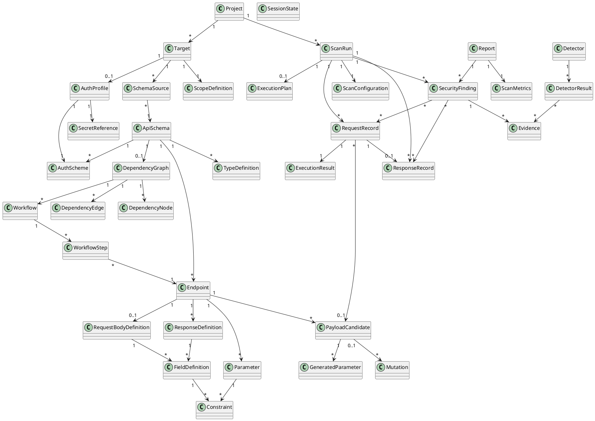

# YSLFuzz — Data Model Specification (DMS)

**Project:** YSLFuzz  
**Subtitle:** Schema-Aware Stateful Fuzzer for REST and GraphQL APIs  
**Version:** 1.0  
**Author:** Christian Ruzza  
**Status:** Draft operativo pre-sviluppo  

---

## 1. Purpose

Questo documento definisce il modello dati interno di **YSLFuzz**.  
Il Data Model Specification descrive le entità, gli attributi, le relazioni, gli enum, le regole di validazione e le strutture dati necessarie per implementare il framework.

Il modello dati deve supportare:

- rappresentazione unificata di API REST e GraphQL;
- generazione payload schema-aware;
- workflow stateful;
- request/response recording;
- vulnerability findings;
- metriche e report riproducibili;
- redazione di dati sensibili.

---

## 2. Design Principles

### 2.1 Uniform internal model

REST e GraphQL devono essere normalizzati in entità comuni:

- `ApiSchema`;
- `Endpoint`;
- `Parameter`;
- `FieldDefinition`;
- `PayloadCandidate`;
- `RequestRecord`;
- `ResponseRecord`;
- `SecurityFinding`.

### 2.2 Reproducibility

Ogni scan deve poter essere riprodotto tramite:

- configurazione;
- seed;
- schema sorgente;
- payload generati;
- richieste;
- risposte;
- finding;
- metriche.

### 2.3 Sensitive data protection

Il modello deve distinguere dati runtime e dati persistibili. Token, password, cookie e API key devono essere redatti nei report.

---

## 3. Enumerations

### 3.1 ApiStyle

```text
REST
GRAPHQL
UNKNOWN
```

### 3.2 Protocol

```text
HTTP
HTTPS
```

### 3.3 HttpMethod

```text
GET
POST
PUT
PATCH
DELETE
HEAD
OPTIONS
```

### 3.4 ParameterLocation

```text
PATH
QUERY
HEADER
COOKIE
BODY
GRAPHQL_VARIABLE
GRAPHQL_ARGUMENT
```

### 3.5 FieldType

```text
STRING
INTEGER
FLOAT
BOOLEAN
OBJECT
ARRAY
ENUM
UUID
EMAIL
URI
DATE
DATETIME
PASSWORD
TOKEN
FILE
UNKNOWN
```

### 3.6 AuthType

```text
NONE
BASIC
BEARER
JWT
API_KEY
COOKIE
OAUTH2
CUSTOM
```

### 3.7 ConstraintType

```text
REQUIRED
MIN_LENGTH
MAX_LENGTH
MIN_VALUE
MAX_VALUE
REGEX
ENUM
FORMAT
DEFAULT
NULLABLE
UNIQUE
READ_ONLY
WRITE_ONLY
```

### 3.8 PayloadKind

```text
VALID
BOUNDARY
MUTATED
ATTACK
INVALID
CONTROL
```

### 3.9 AttackCategory

```text
SQL_INJECTION
NOSQL_INJECTION
COMMAND_INJECTION
SSRF
XSS
MASS_ASSIGNMENT
BROKEN_ACCESS_CONTROL
GRAPHQL_DEPTH_ABUSE
GRAPHQL_INTROSPECTION_ABUSE
GRAPHQL_BATCHING_ABUSE
AUTH_BYPASS
INPUT_VALIDATION
INFORMATION_DISCLOSURE
```

### 3.10 ExecutionStatus

```text
PENDING
RUNNING
COMPLETED
FAILED
SKIPPED
TIMEOUT
BLOCKED
```

### 3.11 FindingSeverity

```text
INFO
LOW
MEDIUM
HIGH
CRITICAL
```

### 3.12 FindingConfidence

```text
LOW
MEDIUM
HIGH
CONFIRMED
```

### 3.13 FindingStatus

```text
OPEN
CONFIRMED
FALSE_POSITIVE
IGNORED
FIXED
```

---

## 4. Project and Scan Configuration Model

## 4.1 Project

Represents a YSLFuzz project.

```text
project_id: str
name: str
description: str | null
created_at: datetime
updated_at: datetime
targets: list[Target]
scans: list[ScanRun]
metadata: dict
```

Rules:

- `project_id` must be unique;
- `name` is required;
- a project can contain multiple targets and scans.

---

## 4.2 Target

Represents the API target.

```text
target_id: str
name: str
base_url: str
api_style: ApiStyle
protocol: Protocol
scope: ScopeDefinition
auth_profile: AuthProfile | null
schema_sources: list[SchemaSource]
metadata: dict
```

Rules:

- `base_url` must be valid;
- scope must be explicit;
- auth profile is optional.

---

## 4.3 ScopeDefinition

Defines the legal and operational boundaries of the scan.

```text
allowed_hosts: list[str]
allowed_paths: list[str]
blocked_paths: list[str]
max_requests: int | null
max_duration_seconds: int | null
rate_limit_per_second: int | null
allow_destructive_methods: bool
allowed_methods: list[HttpMethod]
```

Default rule:

```text
allow_destructive_methods = false
```

---

## 4.4 ScanConfiguration

Defines how a scan should run.

```text
scan_config_id: str
target_id: str
enabled_attack_categories: list[AttackCategory]
enabled_payload_kinds: list[PayloadKind]
max_depth: int
max_concurrency: int
request_timeout_seconds: float
follow_redirects: bool
verify_tls: bool
random_seed: int
store_raw_responses: bool
redact_sensitive_data: bool
```

Recommended MVP defaults:

```text
max_depth = 3
max_concurrency = 10
request_timeout_seconds = 10.0
follow_redirects = false
verify_tls = true
store_raw_responses = false
redact_sensitive_data = true
```

---

## 5. API Schema Model

## 5.1 SchemaSource

Represents the source from which the API schema is imported.

```text
source_id: str
source_type: str
location: str
api_style: ApiStyle
raw_content_hash: str | null
imported_at: datetime
parser_version: str
metadata: dict
```

Supported source types:

```text
OPENAPI_FILE
OPENAPI_URL
SWAGGER_FILE
SWAGGER_URL
GRAPHQL_INTROSPECTION
GRAPHQL_SCHEMA_FILE
MANUAL
```

---

## 5.2 ApiSchema

Normalized internal API representation.

```text
api_schema_id: str
target_id: str
title: str | null
version: str | null
api_style: ApiStyle
base_url: str
endpoints: list[Endpoint]
types: list[TypeDefinition]
auth_schemes: list[AuthScheme]
created_from: list[SchemaSource]
metadata: dict
```

---

## 5.3 Endpoint

Represents a REST endpoint or GraphQL operation.

```text
endpoint_id: str
api_schema_id: str
name: str
api_style: ApiStyle
path: str
method: HttpMethod | null
graphql_operation_type: str | null
graphql_operation_name: str | null
summary: str | null
description: str | null
auth_required: bool
deprecated: bool
parameters: list[Parameter]
request_body: RequestBodyDefinition | null
responses: list[ResponseDefinition]
tags: list[str]
metadata: dict
```

Validation rules:

- REST endpoint requires `method` and `path`;
- GraphQL operation requires `graphql_operation_type` and `graphql_operation_name`.

---

## 5.4 Parameter

Represents an input parameter.

```text
parameter_id: str
name: str
location: ParameterLocation
field_type: FieldType
required: bool
constraints: list[Constraint]
default_value: Any | null
example_value: Any | null
description: str | null
sensitive: bool
metadata: dict
```

---

## 5.5 RequestBodyDefinition

Represents expected request body.

```text
request_body_id: str
content_type: str
required: bool
root_type: TypeReference | null
fields: list[FieldDefinition]
examples: list[ExampleValue]
metadata: dict
```

Supported MVP content types:

```text
application/json
application/graphql
```

---

## 5.6 ResponseDefinition

Represents possible response schema.

```text
response_definition_id: str
status_code: int | str
description: str | null
content_type: str | null
body_type: TypeReference | null
fields: list[FieldDefinition]
metadata: dict
```

---

## 5.7 FieldDefinition

Represents a field in a structured object.

```text
field_id: str
name: str
field_type: FieldType
required: bool
nullable: bool
read_only: bool
write_only: bool
sensitive: bool
constraints: list[Constraint]
nested_fields: list[FieldDefinition]
array_item_type: TypeReference | null
description: str | null
example_value: Any | null
metadata: dict
```

Rules:

- if `field_type = OBJECT`, nested fields may be present;
- if `field_type = ARRAY`, item type should be present;
- if `sensitive = true`, values must be redacted.

---

## 5.8 TypeDefinition

Represents a complex type.

```text
type_id: str
name: str
api_style: ApiStyle
field_type: FieldType
fields: list[FieldDefinition]
enum_values: list[str] | null
description: str | null
metadata: dict
```

---

## 5.9 Constraint

Represents a field or parameter constraint.

```text
constraint_id: str
constraint_type: ConstraintType
value: Any
source: str
description: str | null
```

---

## 6. Authentication Model

## 6.1 AuthScheme

```text
auth_scheme_id: str
auth_type: AuthType
name: str
location: ParameterLocation | null
header_name: str | null
query_param_name: str | null
cookie_name: str | null
description: str | null
metadata: dict
```

## 6.2 AuthProfile

```text
auth_profile_id: str
name: str
auth_scheme_id: str
credential_ref: SecretReference
login_workflow_id: str | null
refresh_workflow_id: str | null
metadata: dict
```

## 6.3 SecretReference

```text
secret_ref_id: str
secret_type: str
provider: str
key_name: str
redacted_preview: str | null
created_at: datetime
```

Rule:

- secret values must never be serialized in reports.

---

## 7. Dependency Graph Model

## 7.1 DependencyGraph

```text
dependency_graph_id: str
api_schema_id: str
nodes: list[DependencyNode]
edges: list[DependencyEdge]
created_at: datetime
metadata: dict
```

## 7.2 DependencyNode

```text
node_id: str
node_type: str
ref_id: str
label: str
metadata: dict
```

Supported node types:

```text
ENDPOINT
FIELD
TYPE
VALUE
AUTH_STATE
WORKFLOW_STEP
```

## 7.3 DependencyEdge

```text
edge_id: str
source_node_id: str
target_node_id: str
dependency_type: str
confidence: FindingConfidence
evidence: str | null
metadata: dict
```

Supported dependency types:

```text
PRODUCES
CONSUMES
REQUIRES_AUTH
RETURNS_ID
USES_ID
CREATES_RESOURCE
READS_RESOURCE
UPDATES_RESOURCE
DELETES_RESOURCE
```

## 7.4 Workflow

```text
workflow_id: str
name: str
description: str | null
steps: list[WorkflowStep]
required_auth: bool
destructive: bool
confidence: FindingConfidence
metadata: dict
```

## 7.5 WorkflowStep

```text
workflow_step_id: str
endpoint_id: str
order: int
input_bindings: list[VariableBinding]
output_extractors: list[ValueExtractor]
expected_status_codes: list[int]
optional: bool
metadata: dict
```

---

## 8. Payload Model

## 8.1 PayloadCandidate

```text
payload_id: str
endpoint_id: str
payload_kind: PayloadKind
attack_category: AttackCategory | null
content_type: str
body: dict | str | null
parameters: list[GeneratedParameter]
headers: dict
cookies: dict
generation_strategy: str
seed: int
parent_payload_id: str | null
metadata: dict
```

Rules:

- `ATTACK` payload requires `attack_category`;
- sensitive values must be redacted in serialized artifacts;
- `parent_payload_id` links mutations to base payloads.

## 8.2 GeneratedParameter

```text
generated_parameter_id: str
name: str
location: ParameterLocation
value: Any
field_type: FieldType
source_field_id: str | null
valid_against_schema: bool
mutation_applied: bool
sensitive: bool
metadata: dict
```

## 8.3 Mutation

```text
mutation_id: str
name: str
description: str
attack_category: AttackCategory | null
target_field_type: FieldType
target_location: ParameterLocation | null
mutation_operator: str
safe_label: str
metadata: dict
```

---

## 9. Execution Model

## 9.1 ScanRun

```text
scan_run_id: str
project_id: str
target_id: str
scan_config_id: str
status: ExecutionStatus
started_at: datetime
finished_at: datetime | null
api_schema_id: str
dependency_graph_id: str | null
execution_plan_id: str | null
summary_metrics: ScanMetrics | null
metadata: dict
```

## 9.2 ExecutionPlan

```text
execution_plan_id: str
scan_run_id: str
workflows: list[Workflow]
standalone_payloads: list[PayloadCandidate]
max_concurrency: int
estimated_request_count: int
created_at: datetime
metadata: dict
```

## 9.3 SessionState

```text
session_state_id: str
cookies: dict
headers: dict
auth_tokens: dict
last_response_id: str | null
created_at: datetime
updated_at: datetime
sensitive_keys: list[str]
```

## 9.4 RequestRecord

```text
request_id: str
scan_run_id: str
endpoint_id: str
payload_id: str | null
workflow_id: str | null
workflow_step_id: str | null
method: HttpMethod
url: str
headers: dict
query_params: dict
path_params: dict
cookies: dict
body: dict | str | null
content_type: str | null
sent_at: datetime
metadata: dict
```

## 9.5 ResponseRecord

```text
response_id: str
request_id: str
status_code: int
headers: dict
cookies: dict
body_preview: str | null
body_hash: str | null
body_size_bytes: int
response_time_ms: float
received_at: datetime
error: str | null
metadata: dict
```

## 9.6 ExecutionResult

```text
execution_result_id: str
request_id: str
response_id: str | null
status: ExecutionStatus
error_type: str | null
error_message: str | null
retry_count: int
metadata: dict
```

---

## 10. Analysis and Finding Model

## 10.1 Detector

```text
detector_id: str
name: str
attack_category: AttackCategory
description: str
enabled: bool
version: str
metadata: dict
```

## 10.2 DetectorResult

```text
detector_result_id: str
detector_id: str
request_id: str
response_id: str | null
matched: bool
confidence: FindingConfidence
severity: FindingSeverity
evidence: list[Evidence]
reason: str | null
metadata: dict
```

## 10.3 Evidence

```text
evidence_id: str
evidence_type: str
source: str
description: str
request_id: str | null
response_id: str | null
field_name: str | null
observed_value_preview: str | null
redacted: bool
metadata: dict
```

## 10.4 SecurityFinding

```text
finding_id: str
scan_run_id: str
endpoint_id: str
title: str
description: str
attack_category: AttackCategory
severity: FindingSeverity
confidence: FindingConfidence
status: FindingStatus
affected_parameter: str | null
affected_location: ParameterLocation | null
payload_id: str | null
request_ids: list[str]
response_ids: list[str]
evidence: list[Evidence]
recommendation: str | null
created_at: datetime
metadata: dict
```

Validation rules:

- at least one request is required;
- severity and confidence are required;
- high severity findings require evidence;
- secrets must be redacted.

---

## 11. Reporting and Metrics Model

## 11.1 ScanMetrics

```text
metrics_id: str
scan_run_id: str
total_endpoints: int
tested_endpoints: int
total_requests: int
successful_requests: int
failed_requests: int
timeout_requests: int
payloads_generated: int
valid_payloads_generated: int
attack_payloads_generated: int
findings_total: int
findings_by_severity: dict
average_response_time_ms: float
endpoint_coverage: float
payload_validity_rate: float
metadata: dict
```

Formulas:

```text
endpoint_coverage = tested_endpoints / total_endpoints
payload_validity_rate = valid_payloads_generated / payloads_generated
```

## 11.2 Report

```text
report_id: str
scan_run_id: str
format: str
generated_at: datetime
summary: ReportSummary
findings: list[SecurityFinding]
metrics: ScanMetrics
redaction_enabled: bool
metadata: dict
```

Supported formats:

```text
JSON
MARKDOWN
HTML
```

---

## 12. Data Lifecycle

### 12.1 Discovery phase

Creates:

```text
SchemaSource
ApiSchema
Endpoint
Parameter
TypeDefinition
FieldDefinition
Constraint
AuthScheme
```

### 12.2 Dependency phase

Creates:

```text
DependencyGraph
DependencyNode
DependencyEdge
Workflow
WorkflowStep
VariableBinding
ValueExtractor
```

### 12.3 Payload generation phase

Creates:

```text
PayloadCandidate
GeneratedParameter
Mutation
```

### 12.4 Execution phase

Creates:

```text
ScanRun
ExecutionPlan
SessionState
RequestRecord
ResponseRecord
ExecutionResult
```

### 12.5 Analysis phase

Creates:

```text
DetectorResult
Evidence
SecurityFinding
```

### 12.6 Reporting phase

Creates:

```text
ScanMetrics
Report
```

---

## 13. UML Class Diagram



---

## 14. MVP Data Model

Must implement before meaningful fuzzing:

```text
Project
Target
ScopeDefinition
ScanConfiguration
SchemaSource
ApiSchema
Endpoint
Parameter
RequestBodyDefinition
ResponseDefinition
FieldDefinition
Constraint
AuthScheme
DependencyGraph
DependencyNode
DependencyEdge
Workflow
WorkflowStep
PayloadCandidate
GeneratedParameter
ScanRun
ExecutionPlan
SessionState
RequestRecord
ResponseRecord
ExecutionResult
DetectorResult
Evidence
SecurityFinding
ScanMetrics
Report
```

Can be deferred:

```text
Advanced SecretReference
OAuth2 full modeling
FindingFingerprint
GraphQL subscriptions
Distributed scan models
LLM-assisted models
```

---

## 15. Python Implementation Guidelines

Recommended package:

```text
yslfuzz/models/
├── enums.py
├── base.py
├── project.py
├── schema.py
├── auth.py
├── dependency.py
├── payload.py
├── execution.py
├── analysis.py
└── reporting.py
```

Recommended base class:

```python
from typing import Any
from pydantic import BaseModel, Field

class YSLFuzzModel(BaseModel):
    metadata: dict[str, Any] = Field(default_factory=dict)
```

Recommended ID strategy:

```text
project_<uuid>
target_<uuid>
endpoint_<uuid>
payload_<uuid>
request_<uuid>
response_<uuid>
finding_<uuid>
scan_<uuid>
```
